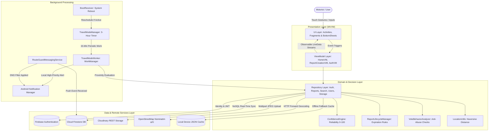
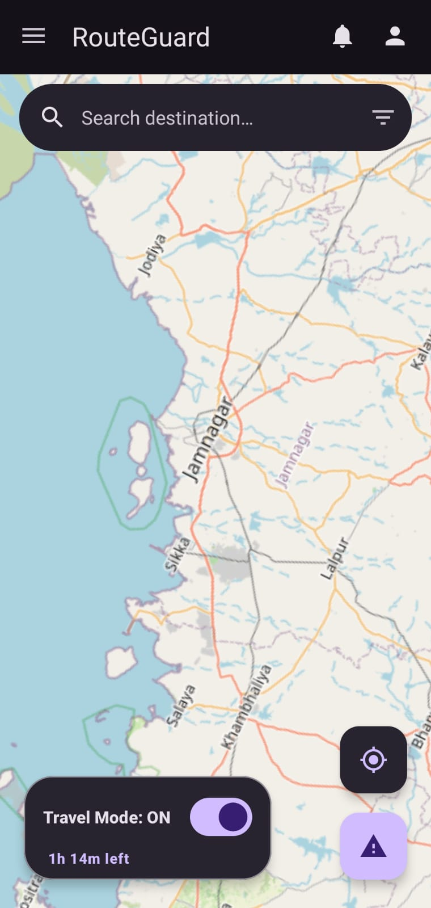
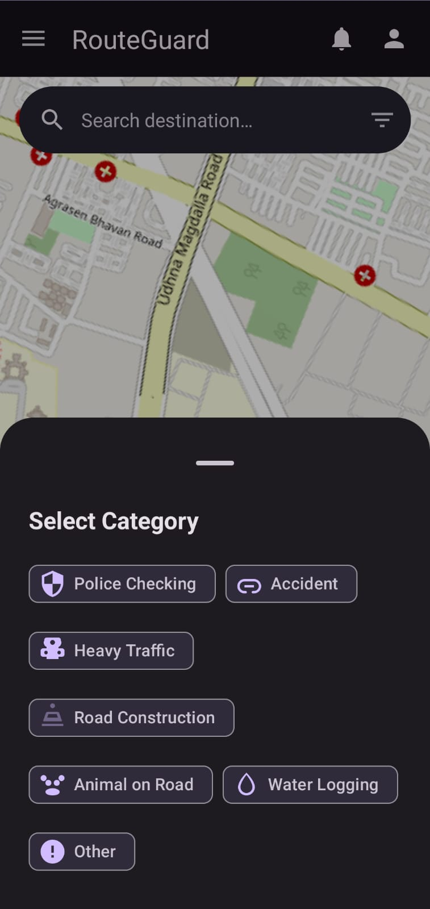
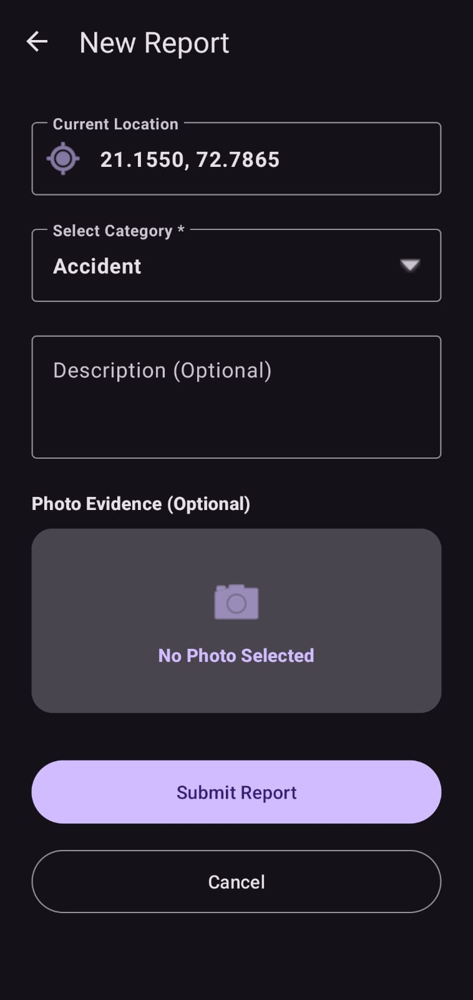
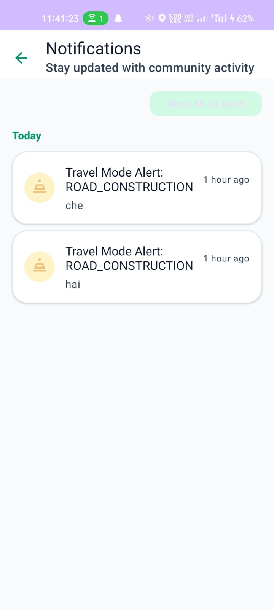
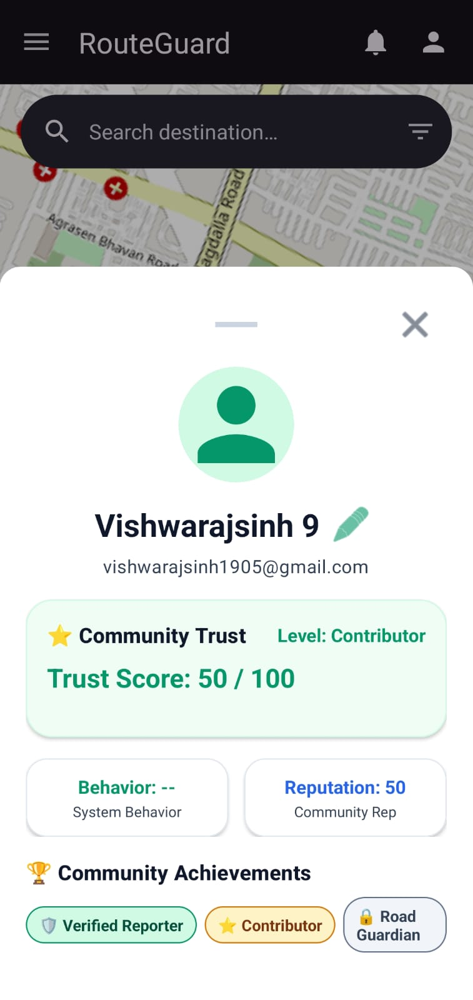
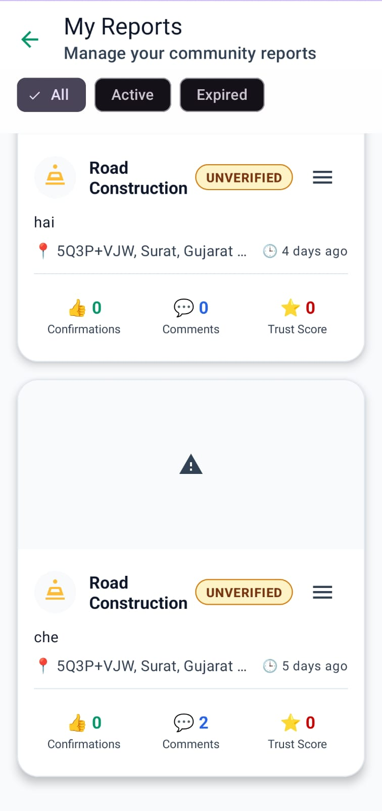

<p align="center">
  
</p>

# 🛡️ SafeRoute — Comprehensive Technical Documentation & Architecture Manual

> **Know Before You Go** — A modern, community-driven road safety, real-time hazard intelligence, and proximity alert application for Android.

---

## 📋 Table of Contents
1. [SECTION 1 — Project Overview](#section-1--project-overview)
2. [SECTION 2 — Project Objectives and Implemented Features](#section-2--project-objectives-and-implemented-features)
3. [SECTION 3 — Project Structure and File Responsibilities](#section-3--project-structure-and-file-responsibilities)
4. [SECTION 4 — Technology Stack and Requirements](#section-4--technology-stack-and-requirements)
5. [SECTION 5 — Complete Project Architecture](#section-5--complete-project-architecture)
   - [5.1 Architecture Overview](#51-architecture-overview)
   - [5.2 Architecture Diagram](#52-architecture-diagram)
   - [5.3 Component Responsibilities](#53-component-responsibilities)
   - [5.4 End-to-End Execution Flow](#54-end-to-end-execution-flow)
6. [SECTION 6 — Complete User and Data Flow](#section-6--complete-user-and-data-flow)
   - [A. Startup Flow](#a-startup-flow)
   - [B. Registration Flow](#b-registration-flow)
   - [C. Login Flow](#c-login-flow)
   - [D. Forgot-Password Flow](#d-forgot-password-flow)
   - [E. Map and Place-Search Flow](#e-map-and-place-search-flow)
   - [F. Hazard Selection and Report Preparation Flow](#f-hazard-selection-and-report-preparation-flow)
   - [G. Photo-Upload Flow](#g-photo-upload-flow)
   - [H. Report-Submission Flow](#h-report-submission-flow)
   - [I. Report-Retrieval and Viewing Flow](#i-report-retrieval-and-viewing-flow)
   - [J. Voting, Confirmations, and Comments Flow](#j-voting-confirmations-and-comments-flow)
   - [K. Profile Flow](#k-profile-flow)
   - [L. Notification and Background Flow](#l-notification-and-background-flow)
   - [M. Error Handling and Offline Behaviour](#m-error-handling-and-offline-behaviour)
7. [SECTION 7 — Database Architecture and Data Persistence](#section-7--database-architecture-and-data-persistence)
   - [Firebase Authentication](#firebase-authentication)
   - [Cloud Firestore Schema](#cloud-firestore-schema)
   - [Image Storage (Cloudinary REST)](#image-storage-cloudinary-rest)
   - [Data Lifecycle](#data-lifecycle)
8. [SECTION 8 — Core Algorithms and Technical Concepts](#section-8--core-algorithms-and-technical-concepts)
9. [SECTION 9 — Installation and Setup](#section-9--installation-and-setup)
10. [SECTION 10 — Testing and Verification](#section-10--testing-and-verification)
11. [SECTION 11 — Limitations and Future Work](#section-11--limitations-and-future-work)
12. [SECTION 12 — References and Resources](#section-12--references-and-resources)

---

## SECTION 1 — Project Overview

### 1.1 What SafeRoute Does
**SafeRoute** is a native Android application designed to improve everyday road travel through crowdsourced safety intelligence, real-time hazard reporting, and automated proximity alerts. Built entirely in Java using Material 3 safety design tokens and OpenStreetMap (OSMDroid), SafeRoute empowers drivers, cyclists, and daily commuters to document roadway incidents (accidents, construction, water logging, potholes, traffic congestion, and police checkpoints) and share peer-verified updates with other road users within a configurable geographic radius.

### 1.2 The Problem It Addresses
Roadway conditions are inherently dynamic. Municipal road repairs, sudden water logging after downpours, unexpected traffic stalls, and accidents often go unannounced on traditional static navigation platforms or suffer from significant reporting latency. Commuters frequently encounter hazards without warning, leading to preventable vehicle wear, traffic congestion, and dangerous driving scenarios. SafeRoute addresses this gap by creating an open, community-governed safety layer where travelers directly report hazards they encounter and collectively verify active reports in real time.

### 1.3 Intended Users
- **Daily Commuters & Drivers**: Motorists seeking real-time awareness of road obstacles, closures, and slowdowns on their daily routes.
- **Two-Wheeler Riders & Cyclists**: Vulnerable road users who require timely warnings about localized physical hazards like potholes, oil slicks, and flooded underpasses.
- **Community Safety Contributors**: Engaged civic participants who report road conditions to help fellow citizens travel safely.

### 1.4 Purpose of Community-Driven Hazard Reporting
Centralized authorities often lack the localized agility to detect and broadcast temporary hazards instantly. A crowdsourced approach distributes observation across all active motorists. To ensure high data integrity, SafeRoute pairs crowdsourced reporting with a **multi-user validation engine**: reports are subjected to peer voting (upvoting/downvoting), physical existence confirmations (*"Still Exists"* vs. *"Cleared / Not Found"*), time-to-live (TTL) expiration rules, and anti-abuse behavioral analysis.

### 1.5 How Users Discover, Submit, and Review Hazards
- **Discover**: An interactive OpenStreetMap canvas renders live hazard markers categorized by custom icons and color-coded by confidence tiers. A search bar with debounced autocompletion (OpenStreetMap Nominatim API) allows quick exploration of any destination.
- **Submit**: A streamlined report creation flow enables users to specify hazard category, geographic coordinates, optional photo attachments (captured via device camera and hosted on Cloudinary), and textual descriptions.
- **Review**: Tapping any marker opens an expandable bottom sheet providing report photos, time-elapsed timestamps, author reputation, upvote/downvote tallies, community existence confirmations, and real-time discussion comments.

### 1.6 Application Objective
The primary objective of SafeRoute is to deliver a reliable, privacy-respecting, and community-driven road safety intelligence platform. The project avoids unverified marketing claims regarding accident elimination or AI-based crash prediction; its purpose is to provide transparent, peer-verified situational awareness directly to motorists on the road.

---

## SECTION 2 — Project Objectives and Implemented Features

Every feature described below has been verified against the actual SafeRoute source code:

| Feature | Access Point | Implementing Files | Key Functions & Components | Android / Firebase Concepts |
| :--- | :--- | :--- | :--- | :--- |
| **Startup & Splash Routing** | App launch (`MAIN` / `LAUNCHER`) | `SplashActivity.java`, `SessionManager.java` | `startFadeInAnimation()`, `navigateToNextScreenAfterDelay()`, `SessionManager.isLoggedIn()` | Android ViewBinding, ObjectAnimator/AlphaAnimation, Handler Looper, Intent flags (`FLAG_ACTIVITY_CLEAR_TASK`) |
| **User Registration** | `AuthenticationActivity` -> `RegisterFragment` | `RegisterFragment.java`, `AuthenticationViewModel.java`, `AuthenticationRepository.java`, `LocalAuthManager.java` | `authViewModel.register()`, `authRepository.register()`, `LocalAuthManager.saveUser()` | Firebase Auth `createUserWithEmailAndPassword`, Firestore `users` document creation, LiveData |
| **User Login** | `AuthenticationActivity` -> `LoginFragment` | `LoginFragment.java`, `AuthenticationViewModel.java`, `AuthenticationRepository.java`, `SessionManager.java` | `authViewModel.login()`, `authRepository.login()`, `syncUserPostLogin()` | Firebase Auth `signInWithEmailAndPassword`, offline credential cache, FCM token sync |
| **Forgot Password** | `LoginFragment` ("Forgot Password?") | `LoginFragment.java`, `AuthenticationViewModel.java`, `AuthenticationRepository.java` | `authViewModel.sendPasswordResetEmail()`, `firebaseAuth.sendPasswordResetEmail()` | Firebase Auth password recovery REST triggers, LiveData error/success binding |
| **Interactive Map Display** | `HomeActivity` main view | `HomeActivity.java`, `MapManager.java`, `MarkerManager.java`, `MarkerFactory.java` | `mapManager.initialize()`, `mapView.setTileSource()`, `markerManager.applyUpdates()` | OSMDroid `MapView`, MAPNIK tile provider, multi-touch gestures, DPI tile scaling |
| **Live Device Location** | `HomeActivity` GPS trigger | `HomeActivity.java`, `UserLocationManager.java`, `LocationUtils.java` | `userLocationManager.checkAndFetchLocation()`, `LocationUtils.calculateDistanceKm()` | Google Play Services `FusedLocationProviderClient`, `LocationRequest.PRIORITY_HIGH_ACCURACY`, runtime permission contract |
| **Place Search & Autocomplete** | `HomeActivity` top search bar | `HomeActivity.java`, `HomeViewModel.java`, `SearchRepository.java`, `NominatimService.java`, `PlacesAdapter.java` | `homeViewModel.searchPlaces()`, `nominatimService.searchPlaces()`, `placesAdapter.setPlaces()` | Retrofit 2 HTTP GET, debounced input via `Handler.postDelayed()`, Gson parsing, Nominatim API |
| **Category Selection** | Report draft dialog & filter sheet | `CategorySelectionBottomSheet.java`, `FiltersBottomSheet.java`, `ReportType.java` | `show()`, `setOnCategorySelectedListener()`, `ReportType.fromDisplayName()` | Material 3 `BottomSheetDialogFragment`, enum mapping, custom category drawables |
| **Camera & Photo Capture** | `ReportActivity` camera card | `ReportActivity.java`, `CameraCaptureManager.java`, `CameraPermissionManager.java` | `checkAndRequestCameraPermission()`, `cameraLauncher.launch()`, `createImageUri()` | AndroidX `ActivityResultContracts.TakePicture`, `FileProvider` (`content://...`), Scoped Storage compliance |
| **Image Compression & Upload** | `ReportActivity` -> Submit | `PhotoCompressionManager.java`, `UploadManager.java`, `StorageRepository.java` | `compress()`, `uploadManager.upload()`, `executeUpload()` | JPEG matrix downsampling, OkHttp multipart HTTP POST to Cloudinary REST endpoint |
| **Report Submission** | `ReportActivity` ("Submit Report") | `ReportActivity.java`, `ReportCreationViewModel.java`, `ReportCreationRepository.java`, `LocalReportManager.java` | `viewModel.submitReport()`, `reportCreationRepo.submitReport()`, `localReportManager.saveReport()` | Cloud Firestore `reports/{reportId}` write, local JSON file backup, duplicate detection |
| **Report Retrieval & Overlays** | `HomeActivity` real-time feed | `HomeViewModel.java`, `FirestoreRepository.java`, `ReportRepository.java`, `MarkerManager.java` | `homeViewModel.getReports()`, `firestoreRepo.listenToReports()`, `markerManager.setReports()` | Firestore real-time snapshot listeners, Haversine radius filtering, lifecycle expiration pruning |
| **Report Details View** | Marker tap on map | `ReportDetailsBottomSheet.java`, `ReportRepository.java`, `ConfidenceEngine.java` | `ReportDetailsBottomSheet.newInstance()`, `loadReportAtIndex()`, `calculateConfidence()` | Two-phase bottom sheet expansion, cluster navigation (Prev/Next), Glide image rendering |
| **Community Voting** | `ReportDetailsBottomSheet` up/down buttons | `VotingManager.java`, `VoteRepository.java`, `VoteFirestoreRepository.java`, `VoteBehaviorAnalyzer.java` | `votingManager.vote()`, `voteRepo.saveVote()`, `behaviorAnalyzer.analyze()` | Firestore subcollection `reports/{reportId}/votes/{userId}`, atomic increment, negative vote ratio analysis |
| **Existence Confirmations** | `ReportDetailsBottomSheet` status chips | `ConfirmationManager.java`, `ConfirmationRepository.java` | `confirmationManager.confirmReport()`, `calculateConfirmationCount()` | Firestore subcollection `reports/{reportId}/confirmations/{userId}`, 5-minute cooldown enforcement |
| **Discussion & Comments** | `ReportDetailsBottomSheet` comments list | `CommentRepository.java`, `CommentAdapter.java`, `Comment.java` | `commentRepo.getComments()`, `commentRepo.addComment()`, `commentAdapter.setComments()` | Firestore subcollection `reports/{reportId}/comments/{commentId}`, snapshot listener, character limit validation |
| **Travel Mode Proximity Alerts** | `HomeActivity` Travel Mode switch | `TravelModeManager.java`, `TravelModeWorker.java`, `BootReceiver.java` | `enableTravelMode()`, `evaluateAndNotifyReports()`, `scheduleBackgroundWorker()` | AndroidX WorkManager `PeriodicWorkRequest` (15 min), 3-hour auto-expiration, notification cooldowns |
| **Push & System Notifications** | Background & foreground events | `RouteGuardMessagingService.java`, `NotificationActivity.java`, `NotificationRepository.java` | `onMessageReceived()`, `onNewToken()`, `saveNotification()` | Firebase Cloud Messaging (FCM), Android 8+ Notification Channels, DND bypass logic for hazards |
| **User Profile & Reputation** | Profile Bottom Sheet | `ProfileBottomSheet.java`, `UserRepository.java`, `UserFirestoreRepository.java`, `TrustManager.java` | `uploadAndSetProfileImage()`, `userRepo.saveUser()`, `trustManager.calculateTrustScore()` | Firebase Auth `UserProfileChangeRequest`, Cloudinary avatar upload, reputation tiers, 65% peek height |
| **Personal Reports ("My Reports")** | Bottom Nav -> My Reports | `MyReportsActivity.java`, `MyReportsAdapter.java`, `CascadeCleanupManager.java` | `loadReports()`, `cascadeCleanupManager.cleanupReportSubcollections()`, `deleteReport()` | Query by `reporterId`, Chip filtering (All, Active, Expired), recursive subcollection deletion |
| **Settings & Localization** | Settings Activity | `SettingsActivity.java`, `NotificationSettingsActivity.java`, `AboutActivity.java`, `AppPreferences.java` | `applyTheme()`, `applyLanguage()`, `updateSubSwitchesState()` | `AppCompatDelegate.setDefaultNightMode()`, Locale configuration override, SharedPreferences |
| **Offline Resilience** | App-wide | `NetworkUtils.java`, `SnackbarUtils.java`, `LocalReportManager.java`, `LocalAuthManager.java` | `isNetworkAvailable()`, `showOfflineSnackbar()`, `loadLocalReports()` | Broadcast network monitoring, instant snackbar feedback, local JSON storage fallback |

---

## SECTION 3 — Project Structure and File Responsibilities

### 3.1 Directory Tree
```
RouteGuard/
├── app/
│   ├── src/
│   │   ├── main/
│   │   │   ├── java/com/vlabs/routeguard/
│   │   │   │   ├── activities/
│   │   │   │   │   ├── BaseActivity.java                 # Common base activity with theme and locale injection
│   │   │   │   │   ├── HomeActivity.java                 # Main interactive map dashboard, search, and travel mode
│   │   │   │   │   ├── MyReportsActivity.java             # User personal reports list, status filters, and deletion
│   │   │   │   │   └── SplashActivity.java                # Application entry point, session check, and routing
│   │   │   │   ├── adapters/
│   │   │   │   │   ├── CommentAdapter.java                # RecyclerView adapter for report discussion comments
│   │   │   │   │   ├── MyReportsAdapter.java              # RecyclerView adapter for personal authored reports
│   │   │   │   │   ├── NotificationAdapter.java           # RecyclerView adapter for in-app notification items
│   │   │   │   │   └── PlacesAdapter.java                # Autocomplete suggestion adapter for Nominatim geocoding
│   │   │   │   ├── api/
│   │   │   │   │   ├── NominatimService.java             # Retrofit HTTP GET interface for OpenStreetMap search API
│   │   │   │   │   └── RetrofitClient.java               # Singleton OkHttp/Retrofit client configured for Nominatim
│   │   │   │   ├── authentication/
│   │   │   │   │   ├── AuthenticationActivity.java        # Single-activity host for login and registration fragments
│   │   │   │   │   ├── LoginFragment.java                # Email/password authentication and password reset UI
│   │   │   │   │   └── RegisterFragment.java             # New user account registration UI
│   │   │   │   ├── fragments/
│   │   │   │   │   ├── BaseFragment.java                 # Abstract base fragment lifecycle wrapper
│   │   │   │   │   ├── CategorySelectionBottomSheet.java # Hazard category grid picker dialog
│   │   │   │   │   ├── FiltersBottomSheet.java           # Map radius and category filter dialog
│   │   │   │   │   ├── LoginRequiredBottomSheet.java     # Authentication prompt for unauthenticated guest actions
│   │   │   │   │   ├── ProfileBottomSheet.java           # User profile, photo upload, trust score, and reputation
│   │   │   │   │   └── ReportDetailsBottomSheet.java     # Full hazard inspection, voting, confirmations, and comments
│   │   │   │   ├── managers/
│   │   │   │   │   ├── ActivityBehaviorAnalyzer.java     # User activity rate and abuse pattern analyzer
│   │   │   │   │   ├── BehaviorEngine.java               # Composite user behavioral risk assessment engine
│   │   │   │   │   ├── CameraCaptureManager.java         # Camera intent management and temporary image URI provider
│   │   │   │   │   ├── CameraPermissionManager.java      # Runtime CAMERA permission verification helper
│   │   │   │   │   ├── CascadeCleanupManager.java        # Recursive deleter for Firestore report subcollections
│   │   │   │   │   ├── ConfidenceEngine.java             # Dynamic report reliability (0-100) scoring algorithm
│   │   │   │   │   ├── ConfirmationManager.java          # Hazard existence verification ("Still Exists" / "Gone")
│   │   │   │   │   ├── LocalAuthManager.java             # Local file-based offline authentication and session storage
│   │   │   │   │   ├── LocalReportManager.java           # Local device storage persistence and duplicate detection
│   │   │   │   │   ├── MapManager.java                   # OSMDroid MapView setup, overlays, and camera controller
│   │   │   │   │   ├── MarkerFactory.java                # Category and confidence vector marker generator
│   │   │   │   │   ├── MarkerManager.java                # Map marker render loop, radius filtering, and 30s prune
│   │   │   │   │   ├── PhotoAttachmentManager.java       # Report draft photo attachment model binding
│   │   │   │   │   ├── PhotoCompressionManager.java      # High-performance bitmap scaling and JPEG compression
│   │   │   │   │   ├── PhotoValidationManager.java       # Image format and file size validation constraints
│   │   │   │   │   ├── ReportBehaviorAnalyzer.java       # Reporter velocity and duplicate report behavior engine
│   │   │   │   │   ├── ReportLifecycleManager.java       # Category-specific time-to-live (TTL) expiration rules
│   │   │   │   │   ├── SessionManager.java               # Global thread-safe singleton managing active user state
│   │   │   │   │   ├── TravelModeManager.java            # 3-hour Travel Mode lifecycle and proximity alert engine
│   │   │   │   │   ├── TrustManager.java                 # User trust score calculator and reputation level tiering
│   │   │   │   │   ├── UploadManager.java                # Image upload coordinator interfacing with Cloudinary
│   │   │   │   │   ├── UserLocationManager.java          # FusedLocationProviderClient GPS coordinate fetcher
│   │   │   │   │   ├── VoteBehaviorAnalyzer.java         # Anti-abuse analyzer detecting negative vote campaigns
│   │   │   │   │   └── VotingManager.java                # Report upvote/downvote coordinator and score aggregator
│   │   │   │   ├── models/
│   │   │   │   │   ├── BehaviorFlag.java                 # Behavioral risk warning annotation model
│   │   │   │   │   ├── BehaviorMetrics.java              # Aggregated statistical voting and reporting counts
│   │   │   │   │   ├── BehaviorResult.java               # Comprehensive behavioral risk evaluation output
│   │   │   │   │   ├── BehaviorRiskLevel.java            # Risk level enum (NORMAL, LOW, MEDIUM, HIGH)
│   │   │   │   │   ├── Comment.java                      # Road report discussion comment entity
│   │   │   │   │   ├── ConfirmationCount.java            # Active vs gone confirmation tally summary
│   │   │   │   │   ├── NotificationModel.java            # In-app notification domain model
│   │   │   │   │   ├── PhotoAttachment.java              # Photo URI and local file metadata container
│   │   │   │   │   ├── PlaceSuggestion.java              # Nominatim geocoding search result representation
│   │   │   │   │   ├── ReportConfirmation.java           # Single peer confirmation document model
│   │   │   │   │   ├── ReportStatus.java                 # Report lifecycle state (ACTIVE, EXPIRED, RESOLVED)
│   │   │   │   │   ├── ReportType.java                   # Hazard category enum (ACCIDENT, CONSTRUCTION, etc.)
│   │   │   │   │   ├── ReportVote.java                   # Single community vote record model
│   │   │   │   │   ├── RoadReport.java                   # Primary road hazard domain model
│   │   │   │   │   ├── RoadReportDraft.java              # In-progress uncommitted report draft builder
│   │   │   │   │   ├── TrustScore.java                   # User trust score breakdown entity
│   │   │   │   │   ├── User.java                         # User profile domain model (Firestore user document)
│   │   │   │   │   ├── VerificationStatus.java           # Report verification status enum
│   │   │   │   │   ├── VoteCount.java                    # Aggregated upvotes and downvotes tally
│   │   │   │   │   └── VoteResult.java                   # Result container for vote submission operations
│   │   │   │   ├── notifications/
│   │   │   │   │   └── NotificationActivity.java         # Activity feed partitioned by Today, Yesterday, and Older
│   │   │   │   ├── receivers/
│   │   │   │   │   └── BootReceiver.java                 # BroadcastReceiver rescheduling Travel Mode after reboot
│   │   │   │   ├── reports/
│   │   │   │   │   └── ReportActivity.java               # Report drafting UI with camera capture and submission
│   │   │   │   ├── repositories/
│   │   │   │   │   ├── AuthenticationRepository.java     # Hybrid auth repository (LocalAuthManager + Firebase Auth)
│   │   │   │   │   ├── BaseRepository.java               # Base repository utility class
│   │   │   │   │   ├── BehaviorFirestoreRepository.java  # Firestore data layer for user behavioral audit logs
│   │   │   │   │   ├── BehaviorRepository.java           # Behavioral metrics and flags repository
│   │   │   │   │   ├── CommentRepository.java            # Firestore subcollection comments reader and writer
│   │   │   │   │   ├── ConfirmationRepository.java       # Firestore subcollection confirmations reader and writer
│   │   │   │   │   ├── FirestoreRepository.java          # Primary reports collection Firestore CRUD & listeners
│   │   │   │   │   ├── NotificationRepository.java       # Firestore notifications collection reader and writer
│   │   │   │   │   ├── ReportCreationRepository.java     # Two-tier report persistence (local file + Cloud Firestore)
│   │   │   │   │   ├── ReportRepository.java             # Consolidated reports gateway delegating to Firestore
│   │   │   │   │   ├── SearchRepository.java             # Retrofit caller for Nominatim forward geocoding
│   │   │   │   │   ├── StorageRepository.java            # Cloudinary REST multipart image uploader
│   │   │   │   │   ├── TrustFirestoreRepository.java     # Firestore trust score storage and retrieval
│   │   │   │   │   ├── TrustRepository.java              # User trust calculation and persistence layer
│   │   │   │   │   ├── UserFirestoreRepository.java      # Firestore users collection CRUD & FCM token updater
│   │   │   │   │   ├── UserRepository.java               # User profile gateway delegating to UserFirestoreRepository
│   │   │   │   │   ├── VoteFirestoreRepository.java      # Firestore subcollection votes reader and writer
│   │   │   │   │   └── VoteRepository.java               # Vote validation and persistence repository
│   │   │   │   ├── services/
│   │   │   │   │   └── RouteGuardMessagingService.java   # FCM service parsing pushes, applying DND, and saving alerts
│   │   │   │   ├── settings/
│   │   │   │   │   ├── AboutActivity.java                # App version, OSM attribution, and Terms of Service dialogs
│   │   │   │   │   ├── NotificationSettingsActivity.java # Granular switches for hazard/community alerts, DND, sound
│   │   │   │   │   └── SettingsActivity.java             # Theme, language, search radius, and account sign out
│   │   │   │   ├── utils/
│   │   │   │   │   ├── AppPreferences.java               # SharedPreferences wrapper for theme, locale, notifications
│   │   │   │   │   ├── AuthenticationValidator.java      # Pre-submission regex and non-empty validation utility
│   │   │   │   │   ├── BehaviorConfig.java               # Constants and thresholds for anti-abuse algorithms
│   │   │   │   │   ├── DialogUtils.java                  # Material alert dialog helper methods
│   │   │   │   │   ├── FilterPreferences.java            # SharedPreferences manager for map category and radius filters
│   │   │   │   │   ├── FirestoreCollections.java         # Centralized collection name constants
│   │   │   │   │   ├── FirestoreFields.java              # Centralized document field name constants
│   │   │   │   │   ├── IntentConstants.java              # Reusable intent extra keys
│   │   │   │   │   ├── LocationUtils.java                # Haversine and WGS84 distance calculation formulas
│   │   │   │   │   ├── NetworkUtils.java                 # ConnectivityManager active network verification
│   │   │   │   │   ├── RadiusConfig.java                 # Search radius constants and defaults
│   │   │   │   │   ├── ReportDefaults.java               # Default parameters for report creation
│   │   │   │   │   ├── ReportExpirationConfig.java       # Category-specific lifetime durations in milliseconds
│   │   │   │   │   ├── SnackbarUtils.java                # Floating offline and error snackbar visual feedback
│   │   │   │   │   ├── TrustConfig.java                  # Score weights and baseline values for user trust
│   │   │   │   │   ├── TrustRules.java                   # Rules defining reputation tier thresholds
│   │   │   │   │   └── VoteFirestorePaths.java           # Path generator for vote and confirmation subcollections
│   │   │   │   ├── viewmodels/
│   │   │   │   │   ├── AuthenticationState.java          # Sealed-like state classes (Idle, Loading, Success, Error)
│   │   │   │   │   ├── AuthenticationViewModel.java      # Auth UI state holder and validator
│   │   │   │   │   ├── BaseViewModel.java                # Abstract ViewModel lifecycle wrapper
│   │   │   │   │   ├── HomeViewModel.java                # Map reports feed and place search LiveData manager
│   │   │   │   │   ├── ReportCreationViewModel.java      # Draft state, attachment validation, and submission state
│   │   │   │   │   └── SubmissionState.java              # Report creation state (Loading, Success, Duplicate, Error)
│   │   │   │   └── workers/
│   │   │   │       └── TravelModeWorker.java             # WorkManager periodic worker running background proximity checks
│   │   │   ├── res/                                      # XML layouts, drawables, colors, strings, themes, menus
│   │   │   └── AndroidManifest.xml                       # Manifest declarations, permissions, services, receivers
│   │   └── test/java/com/vlabs/routeguard/
│   │       ├── AuthAndProfileTest.java                   # Unit tests for authentication logic and profile flows
│   │       ├── CrashReproducerTest.java                  # Regression unit tests covering edge-case crash scenarios
│   │       ├── ExampleUnitTest.java                      # Standard JUnit assertion tests
│   │       └── ReportCreationTest.java                   # Unit tests verifying report model validation and drafting
│   ├── build.gradle.kts                                  # App-level build script with dependencies and SDK levels
│   └── proguard-rules.pro                                # R8 / ProGuard optimization rules
├── build.gradle.kts                                      # Root build configuration
├── settings.gradle.kts                                   # Gradle subproject inclusions
└── README.md                                             # This comprehensive technical manual
```

---

## SECTION 4 — Technology Stack and Requirements

### 4.1 Exact Version Specifications
All versions listed below are extracted directly from `build.gradle.kts` and `app/build.gradle.kts`:

- **Programming Language**: Java (JDK 17)
- **Compile SDK**: 34 (Android 14)
- **Minimum SDK**: 26 (Android 8.0 Oreo)
- **Target SDK**: 34 (Android 14)
- **Android Gradle Plugin (AGP)**: 8.2.2
- **Kotlin Android Plugin**: 1.9.22
- **Google Services Plugin**: 4.4.2
- **Java Compatibility**: `JavaVersion.VERSION_17` (Source and Target)
- **ViewBinding**: Enabled (`buildFeatures.viewBinding = true`)

### 4.2 Libraries and Dependencies
- **Firebase Platform BOM**: `com.google.firebase:firebase-bom:34.15.0`
  - `firebase-auth`: Email/password authentication, JWT management, profile updates.
  - `firebase-firestore`: Cloud Firestore real-time NoSQL database and offline persistence.
  - `firebase-messaging`: Firebase Cloud Messaging (FCM) for push notifications.
  - `firebase-storage`: Optional cloud storage client.
- **AndroidX & Material Design**:
  - `androidx.appcompat:appcompat:1.7.1`: Backward-compatible base activities and theme delegation.
  - `com.google.android.material:material:1.13.0`: Material Design 3 components, BottomSheetDialog, Switches.
  - `androidx.constraintlayout:constraintlayout:2.2.1`: Responsive XML layout constraints.
  - `androidx.swiperefreshlayout:swiperefreshlayout:1.1.0`: Pull-to-refresh container for lists.
  - `androidx.work:work-runtime:2.9.0`: AndroidX WorkManager for periodic background tasks.
  - `androidx.lifecycle:lifecycle-viewmodel:2.6.2` & `lifecycle-livedata:2.6.2`: Architecture Components.
- **Map & Geocoding**:
  - `org.osmdroid:osmdroid-android:6.1.20`: OpenStreetMap tile rendering, camera animations, and custom overlays.
  - `com.google.android.gms:play-services-location:21.2.0`: FusedLocationProviderClient for high-accuracy GPS coordinates.
  - `com.squareup.retrofit2:retrofit:2.9.0` & `converter-gson:2.9.0`: REST client for OpenStreetMap Nominatim API.
- **Image Processing & Storage**:
  - `com.github.bumptech.glide:glide:4.16.0`: Image caching and asynchronous rendering.
  - `Cloudinary REST API`: Scaled JPEG multipart upload endpoint (`api.cloudinary.com`).
- **Testing Frameworks**:
  - `junit:junit:4.13.2`: Unit testing runner.
  - `org.robolectric:robolectric:4.11.1`: Headless Android runtime unit test environment.
  - `androidx.test.ext:junit:1.1.5` & `androidx.test:core:1.5.0`: AndroidX test extensions.

---

## SECTION 5 — Complete Project Architecture

### 5.1 Architecture Overview
SafeRoute follows the **Model-View-ViewModel (MVVM)** architectural pattern combined with the **Repository Pattern** to ensure strict separation of concerns, testability, and UI independence from data sources.

- **UI Layer (Views)**: Activities (`HomeActivity`, `ReportActivity`, `NotificationActivity`), Fragments (`LoginFragment`, `RegisterFragment`), and BottomSheetDialogs (`ReportDetailsBottomSheet`, `ProfileBottomSheet`). Views observe observable LiveData streams from ViewModels and emit user events.
- **ViewModel Layer**: `HomeViewModel`, `ReportCreationViewModel`, `AuthenticationViewModel`. ViewModels maintain and survive UI configuration changes, execute business validation, and dispatch background tasks to repositories.
- **Repository Layer**: `FirestoreRepository`, `ReportCreationRepository`, `AuthenticationRepository`, `UserRepository`, `SearchRepository`, `NotificationRepository`. Repositories abstract where data comes from (Cloud Firestore, Cloudinary REST API, Nominatim Geocoding, or local device storage files).
- **Subsystem Managers & Engines**: Pure domain logic components like `ConfidenceEngine`, `ReportLifecycleManager`, `TravelModeManager`, `VoteBehaviorAnalyzer`, and `LocationUtils` compute trust, TTL, distance, and abuse scores independently of the UI.

### 5.2 Architecture Diagram



### 5.3 Component Responsibilities
- **Presentation Layer**: Handles view binding, animations, dialog presentation, and user input sanitization. Emits events without knowing whether data comes from network or disk.
- **ViewModel Layer**: Exposes immutable `LiveData` streams representing UI states (`AuthenticationState`, `SubmissionState`). Guarantees no memory leaks by holding application-level contexts only.
- **Domain Engines**: Pure algorithmic classes with zero UI dependencies. `ConfidenceEngine` calculates composite trust scores; `LocationUtils` calculates great-circle distance; `ReportLifecycleManager` enforces category TTL rules.
- **Data Repositories**: Coordinate network calls, Firestore document snapshot mappings, local file persistence, and error normalization.

---

## SECTION 6 — Complete User and Data Flow

### A. Startup Flow
1. **Trigger**: User opens the SafeRoute app from the Android launcher.
2. **Activity Launched**: `com.vlabs.routeguard.activities.SplashActivity`.
3. **Pre-Inflation Initialization**: `AppPreferences` loads persisted theme mode (`applyTheme()`) and preferred locale (`applyLanguage()`) before inflating `activity_splash.xml`.
4. **Branding Animation**: `SplashActivity.startFadeInAnimation()` executes an alpha fade-in on the SafeRoute logo and slogan.
5. **Session Evaluation**: After 1500ms delay on the main Looper, `SessionManager.getInstance().isLoggedIn()` is queried:
   - Evaluates `LocalAuthManager.getInstance().isLoggedIn()` OR `FirebaseAuth.getInstance().getCurrentUser() != null`.
6. **Destination Selection**:
   - If **Authenticated**: Directs to `HomeActivity` with `FLAG_ACTIVITY_NEW_TASK | FLAG_ACTIVITY_CLEAR_TASK`.
   - If **Unauthenticated**: Directs to `AuthenticationActivity` with the same back-stack clearing flags.
7. `finish()` is invoked so the user cannot navigate back to the splash screen.

### B. Registration Flow
1. User navigates to `RegisterFragment` inside `AuthenticationActivity`.
2. Inputs: Email and Password.
3. User taps **Create Account**:
   - `AuthenticationValidator` verifies non-empty email, valid RFC-5322 regex syntax, and password length >= 6 characters.
   - `AuthenticationViewModel` sets `AuthenticationState.Loading()`.
4. `AuthenticationRepository.register()` executes:
   - Immediately provisions local profile in `LocalAuthManager` on device disk for offline resilience.
   - Dispatches `authCallback.onSuccess()`.
   - Silently calls `FirebaseAuth.createUserWithEmailAndPassword()` in the background.
   - On Firebase success, writes initial `User` domain model to Firestore at `users/{userId}` with default trust score (50/100).
5. `RegisterFragment` observes `AuthenticationState.Success()`, displays confirmation toast, and navigates to `HomeActivity`.

### C. Login Flow
1. User enters email and password in `LoginFragment`.
2. User taps **Login**:
   - `AuthenticationValidator` checks for empty fields and syntax.
   - `AuthenticationViewModel` sets `AuthenticationState.Loading()`.
3. `AuthenticationRepository.login()`:
   - Verifies against `LocalAuthManager` local accounts first.
   - Falls back to `FirebaseAuth.signInWithEmailAndPassword()`.
   - On success: synchronizes credentials into `LocalAuthManager`, executes `syncUserPostLogin()` to ensure the `users/{userId}` document exists in Firestore, and uploads the active Firebase Cloud Messaging (FCM) device token via `UserFirestoreRepository.updateFcmToken()`.
4. `LoginFragment` observes `AuthenticationState.Success()`, displays "Login Successful" toast, and launches `HomeActivity`.

### D. Forgot-Password Flow
1. User taps "Forgot Password?" in `LoginFragment`.
2. Validates email non-emptiness.
3. Invokes `AuthenticationRepository.sendPasswordResetEmail()`.
4. Triggers `firebaseAuth.sendPasswordResetEmail(email)`.
5. Surfaces actionable feedback: "Password reset email sent! Check your inbox."

### E. Map and Place-Search Flow
1. `HomeActivity.onCreate()` initializes OSMDroid configuration and custom User-Agent `com.vlabs.routeguard`.
2. `MapManager.initialize()` binds `TileSourceFactory.MAPNIK`, enables multi-touch zoom gestures, and configures DPI tile scaling.
3. `UserLocationManager` requests `ACCESS_FINE_LOCATION` and `ACCESS_COARSE_LOCATION`. Upon GPS fix, adds custom user location overlay and centers the camera on the user's coordinates.
4. User types in search bar: a 400ms debounce Handler prevents excess API traffic.
5. `HomeViewModel.searchPlaces()` invokes `SearchRepository.searchPlaces()` via Retrofit client calling Nominatim REST API:
   - `GET search?q={query}&format=json&addressdetails=1&limit=10`.
6. Results populate `PlacesAdapter`. Selecting a suggestion closes the keyboard, parses `lat` and `lon`, and animates the OSMDroid camera to the chosen location via `mapManager.animateTo()`.

### F. Hazard Selection and Report Preparation Flow
1. User taps the FloatingActionButton (+) or long-presses anywhere on the map.
2. If unauthenticated, `LoginRequiredBottomSheet` appears.
3. If authenticated, `CategorySelectionBottomSheet` allows choosing from 6 hazard categories:
   - `ACCIDENT`, `POLICE`, `HAZARD`, `CLOSURE`, `TRAFFIC`, `ROADWORK`.
4. Coordinates and category are bundled into Intent extras (`EXTRA_LATITUDE`, `EXTRA_LONGITUDE`, `EXTRA_CATEGORY`) and sent to `ReportActivity`.
5. User enters optional description and chooses whether to attach a photograph.

### G. Photo-Upload Flow
1. User taps the photo card in `ReportActivity`.
2. `CameraPermissionManager` verifies `android.permission.CAMERA`.
3. `CameraCaptureManager` creates a secure temporary file in app cache and obtains a `content://` URI via AndroidX `FileProvider` (`com.vlabs.routeguard.fileprovider`).
4. Camera intent (`ActivityResultContracts.TakePicture`) opens system camera.
5. Upon image capture, photo thumbnail displays in `ReportActivity` CardView with Retake/Delete options.
6. Upon report submission, `UploadManager` executes:
   - `PhotoCompressionManager` downsamples image to maximum 1280x1280 resolution at 80% JPEG quality.
   - `StorageRepository` performs an OkHttp multipart POST to Cloudinary REST endpoint (`https://api.cloudinary.com/v1_1/{cloud_name}/image/upload`).
   - Receives HTTPS `secure_url` and `public_id`.
   - If offline or upload fails, falls back gracefully to local file reference so submission is never blocked.

### H. Report-Submission Flow
1. User taps **Submit Report**.
2. Synchronously disables the Submit button to prevent duplicate submissions.
3. Validates network connectivity via `NetworkUtils.isNetworkAvailable()`.
4. `ReportCreationViewModel.submitReport()` checks for duplicates within 50 meters and 10 minutes via `LocalReportManager.isDuplicateReport()`.
5. `ReportCreationRepository`:
   - Computes category-specific TTL expiration epoch via `ReportLifecycleManager.calculateExpiration()`.
   - Generates unique report document ID: `db.collection("reports").document().getId()`.
   - Saves `RoadReport` domain model immediately into `LocalReportManager` on device disk.
   - Dispatches `callback.onSuccess()` to UI immediately.
   - Asynchronously writes `reportData` to Cloud Firestore at `reports/{reportId}`.
6. `ReportActivity` receives `SubmissionState.Success()`, sets `RESULT_OK`, and finishes.
7. `HomeActivity` receives result, re-queries reports, and renders the new hazard marker on the map.

### I. Report-Retrieval and Viewing Flow
1. `HomeViewModel` binds to `FirestoreRepository.listenToReports()`.
2. Listens to real-time snapshot events from `reports` collection ordered by timestamp descending (limit 50).
3. `MarkerManager` receives the report list and executes:
   - Expiration filter: removes reports where `System.currentTimeMillis() >= report.getExpiresAt()`.
   - Radius filter: calculates Haversine distance from user GPS to report coordinates, pruning reports exceeding search radius.
   - Category filter: respects active filter chips.
   - Clusters overlapping markers or renders individual category vector pins.
4. User taps a marker: `MarkerManager.OnReportClickListener` passes `reportIds` to `ReportDetailsBottomSheet.newInstance()`.
5. The bottom sheet opens, loads full report details, displays photo via Glide, and queries author reputation.

### J. Voting, Confirmations, and Comments Flow
- **Voting**:
  - User taps Upvote or Downvote.
  - `VotingManager.vote()` writes `ReportVote` to `reports/{reportId}/votes/{userId}`.
  - Updates atomic upvote/downvote tallies in parent report document.
  - `VoteBehaviorAnalyzer` checks negative vote ratios to prevent malicious downvoting.
- **Confirmations**:
  - User taps *"Still Exists"* or *"Cleared / Not Found"*.
  - `ConfirmationManager.confirmReport()` validates a 5-minute cooldown between changes.
  - Writes `ReportConfirmation` to `reports/{reportId}/confirmations/{userId}`.
  - Re-evaluates `ConfidenceEngine.calculateConfidence()` (0-100 score).
- **Comments**:
  - User types text comment (1-500 characters) and taps Send.
  - `CommentRepository.addComment()` writes `Comment` document to `reports/{reportId}/comments/{commentId}`.
  - Snapshot listener updates `CommentAdapter` in real time.

### K. Profile Flow
1. User taps Profile icon on bottom navigation.
2. `ProfileBottomSheet` opens with 65% peek height (drag-to-expand).
3. Hydrates user data from `UserRepository.getUser()` (display name, email, member since date, trust score).
4. Displays count of authored reports from `ReportRepository` and `LocalReportManager`.
5. User can change profile picture via system gallery picker, uploading to Cloudinary and updating both Firebase Auth and Firestore.
6. User can edit display name inline, persisting changes to Firebase Auth, Firestore, and local cache.

### L. Notification and Background Flow
1. **Push Notifications (FCM)**:
   - Handled by `RouteGuardMessagingService.onMessageReceived()`.
   - Extracts payload, saves `NotificationModel` to Firestore `notifications` collection.
   - Checks `AppPreferences`: evaluates Master switch, Hazard switch, Community switch, and Do Not Disturb (DND). DND silences non-essential community updates while preserving hazard safety alerts.
   - Dispatches Android Notification Channel alert with PendingIntent opening `HomeActivity`.
2. **Travel Mode Proximity Alerts**:
   - Commuter toggles Travel Mode ON in `HomeActivity`.
   - `TravelModeManager.enableTravelMode()` sets 3-hour expiry and schedules `TravelModeWorker` via WorkManager (15-min interval).
   - Worker queries background GPS fix, evaluates nearby active hazards via `LocationUtils`, and posts proximity alerts with a 30-minute cooldown per hazard.
   - When device reboots, `BootReceiver` invokes `TravelModeManager.handleDeviceReboot()`, re-enabling monitoring if the 3-hour window is still active.

### M. Error Handling and Offline Behaviour
- **No Internet**:
  - `NetworkUtils.isNetworkAvailable()` detects connectivity loss.
  - `SnackbarUtils.showOfflineSnackbar()` displays a non-blocking floating alert.
  - Cached map tiles (OSMDroid disk cache) and cached reports (`LocalReportManager`) remain visible.
- **Permission Denials**:
  - Location denied: Map centers on default coordinates (New Delhi: 28.6139, 77.2090) with an option to open device Settings.
  - Camera denied: Camera capture disabled; report submission without photo remains available.
- **Firebase / Network Failures**:
  - Firestore writes fail gracefully, maintaining the report in local file storage so user work is never lost.

---

## SECTION 7 — Database Architecture and Data Persistence

### Firebase Authentication
Handles user credentials, encrypted passwords, JWT tokens, and account authentication states.
- Identity: Unique user ID (`uid`), email, display name, and photo URL.
- Auth Provider: Email/Password authentication.

### Cloud Firestore Schema
Cloud Firestore serves as the primary real-time NoSQL document database.

```
Cloud Firestore
├── users/ (Collection)
│   └── {userId}/ (Document)
│       ├── userId: string (matches Firebase Auth UID)
│       ├── displayName: string
│       ├── email: string
│       ├── photoUrl: string (nullable)
│       ├── createdAt: timestamp (serverTimestamp)
│       ├── lastActiveAt: timestamp (serverTimestamp)
│       ├── trustScore: number (0-100, default: 50)
│       ├── reputationScore: number (0-100, default: 50)
│       ├── fcmToken: string (device registration token)
│       ├── isModerator: boolean (default: false)
│       └── isBlocked: boolean (default: false)
│
├── reports/ (Collection)
│   └── {reportId}/ (Document)
│       ├── reportId: string (auto-generated document ID)
│       ├── type: string (ACCIDENT, POLICE, HAZARD, CLOSURE, TRAFFIC, ROADWORK)
│       ├── latitude: number (double, WGS84)
│       ├── longitude: number (double, WGS84)
│       ├── description: string
│       ├── timestamp: number (epoch milliseconds)
│       ├── expiresAt: number (epoch milliseconds)
│       ├── reporterId: string (UID of author)
│       ├── email: string (author email)
│       ├── imageUrl: string (Cloudinary HTTPS URL or local URI)
│       ├── cloudinaryPublicId: string (nullable)
│       ├── confidenceScore: number (0-100, default: 80)
│       ├── upvotes: number (atomic counter)
│       ├── downvotes: number (atomic counter)
│       ├── activeConfirmations: number (atomic counter)
│       ├── goneConfirmations: number (atomic counter)
│       │
│       ├── votes/ (Subcollection)
│       │   └── {userId}/ (Document)
│       │       ├── voteId: string ("{reportId}_{userId}")
│       │       ├── reportId: string
│       │       ├── userId: string
│       │       ├── voteType: string ("UPVOTE" or "DOWNVOTE")
│       │       ├── timestamp: number (epoch milliseconds)
│       │       └── reportOwnerId: string
│       │
│       ├── confirmations/ (Subcollection)
│       │   └── {userId}/ (Document)
│       │       ├── reportId: string
│       │       ├── userId: string
│       │       ├── status: string ("ACTIVE" or "GONE")
│       │       └── timestamp: number (epoch milliseconds)
│       │
│       └── comments/ (Subcollection)
│           └── {commentId}/ (Document)
│               ├── commentId: string
│               ├── reportId: string
│               ├── userId: string
│               ├── userName: string
│               ├── commentText: string (1-500 chars)
│               └── timestamp: number (epoch milliseconds)
│
└── notifications/ (Collection)
    └── {notificationId}/ (Document)
        ├── notificationId: string
        ├── title: string
        ├── body: string
        ├── timestamp: number (epoch milliseconds)
        ├── isRead: boolean (default: false)
        ├── type: string ("HAZARD" or "COMMUNITY")
        ├── reportId: string (nullable)
        └── userId: string (target recipient UID)
```

### Image Storage (Cloudinary REST)
- Cloudinary REST endpoint (`api.cloudinary.com/v1_1/{cloud_name}/image/upload`) handles multipart JPEG uploads.
- Uploads are managed by `StorageRepository.java` using OkHttp.
- Successful uploads return an HTTPS CDN URL stored in the report's `imageUrl` field and a `cloudinaryPublicId` for asset management.
- The image storage service is completely decoupled from Firestore metadata storage.

### Data Lifecycle
- **Creation**: Reports and notifications are assigned unique document IDs generated by client Firestore references (`collection.document().getId()`).
- **Retrieval**: Queried via batch limit queries (`fetchReports()`) or active snapshot listeners (`listenToReports()`).
- **Update**: Atomic increments (`FieldValue.increment()`) update vote and confirmation counters without race conditions.
- **Deletion & Cascading Cleanup**: Deleting a report via `MyReportsActivity` invokes `CascadeCleanupManager`, which recursively queries and deletes all documents within the `votes`, `confirmations`, and `comments` subcollections before deleting the parent `reports/{reportId}` document.

---

## SECTION 8 — Core Algorithms and Technical Concepts

### 1. Great-Circle Distance (Haversine Formula)
- **Purpose**: Calculate true distance between GPS coordinates on Earth's surface for radius filtering and proximity alerts.
- **Implementing File**: `LocationUtils.java` (`calculateDistanceMeters()`, `calculateDistanceKm()`).
- **Input**: `(startLat, startLon, endLat, endLon)`.
- **Steps**: Calls `android.location.Location.distanceBetween()` which implements the inverse geodetic problem on the WGS84 ellipsoid.
- **Output**: Distance in meters or kilometers. Used by `MarkerManager` and `TravelModeWorker`.

### 2. Dynamic Report Confidence & Reliability Scoring
- **Purpose**: Calculate a live composite reliability score (0-100) reflecting report authenticity.
- **Implementing File**: `ConfidenceEngine.java` (`calculateConfidence()`).
- **Inputs**: Upvotes, downvotes, active confirmations, gone confirmations, report timestamp, expiration timestamp.
- **Formula**:
  $$\text{Score} = 50 + (5 \times \text{upvotes}) - (5 \times \text{downvotes}) + (15 \times \text{activeConf}) - (15 \times \text{goneConf}) - \text{ageHours} - \text{expiryPenalty}$$
  - Where $\text{ageHours} = \lfloor \frac{\text{currentTime} - \text{timestamp}}{3,600,000} \rfloor$
  - Where $\text{expiryPenalty} = 5$ if $(\text{expiresAt} - \text{currentTime}) < 1,800,000$ (under 30 minutes remaining), else $0$.
  - Result is clamped to $[0, 100]$.
- **Output**: Numeric score mapped to `ConfidenceLevel.HIGH` ($\ge 70$), `ConfidenceLevel.MEDIUM` ($20 - 69$), or `ConfidenceLevel.LOW` ($< 20$). Used to color-code map markers.

### 3. Category-Specific Time-to-Live (TTL) Expiration
- **Purpose**: Automatically expire road hazards according to their physical real-world persistence.
- **Implementing File**: `ReportLifecycleManager.java` and `ReportExpirationConfig.java`.
- **Durations**:
  - `ACCIDENT`: 2 hours
  - `POLICE`: 1 hour
  - `HAZARD` (Potholes, Obstacles): 24 hours
  - `CLOSURE`: 12 hours
  - `TRAFFIC`: 1 hour
  - `ROADWORK`: 48 hours
- **Output**: Expiration timestamp (`expiresAt = createdAt + duration`). Evaluated by `MarkerManager`'s 30-second loop to prune stale hazards from the map.

### 4. Duplicate Report Detection
- **Purpose**: Prevent flooding the map with duplicate reports for the same incident.
- **Implementing File**: `LocalReportManager.java` (`isDuplicateReport()`).
- **Rule**: If an existing report matches the requested `ReportType`, is located within $50\text{ meters}$ (Haversine), and was created within the last $10\text{ minutes}$, it is flagged as a duplicate.
- **Output**: Boolean flag. When true, prompts the user to confirm whether they still wish to submit.

### 5. Anti-Abuse Voting Behavior Analysis
- **Purpose**: Identify malicious voting behavior (e.g., targeted downvoting campaigns).
- **Implementing File**: `VoteBehaviorAnalyzer.java` (`analyze()`).
- **Rule**: Requires minimum 5 votes. Computes negative vote ratio: $\frac{\text{negativeVotes}}{\text{totalVotes}}$. If the ratio exceeds $0.80$ (80% downvotes), flags account with elevated `BehaviorRiskLevel.HIGH_RISK`.
- **Output**: `BehaviorResult` used by `TrustManager` to scale down vote influence.

### 6. Travel Mode 3-Hour Proximity Monitoring
- **Purpose**: Provide battery-efficient background hazard alerts while driving without draining resources indefinitely.
- **Implementing File**: `TravelModeManager.java` and `TravelModeWorker.java`.
- **Steps**:
  1. Sets hard expiration: $\text{expiresAt} = \text{now} + 3\text{ hours}$.
  2. Enqueues 15-minute `PeriodicWorkRequest` via WorkManager.
  3. Worker queries background GPS, fetches active reports, evaluates proximity ($< 5\text{ km}$), checks 30-minute notification cooldown, and posts alerts.
  4. At 3 hours, automatically shuts off and cancels background work.

### 7. Do Not Disturb (DND) Safety Priority Filter
- **Purpose**: Suppress social interruptions while driving while ensuring critical danger alerts reach the driver.
- **Implementing File**: `RouteGuardMessagingService.java`.
- **Rule**: If DND is enabled in `AppPreferences`:
  - If notification type is `COMMUNITY` (comments, upvotes) $\rightarrow$ suppressed.
  - If notification type is `HAZARD` or `TRAVEL_ALERT` $\rightarrow$ delivered with high priority.

---

## SECTION 9 — Installation and Setup

### 9.1 Prerequisites
- **Android Studio**: Android Studio Hedgehog (2023.1.1) or newer (Jellyfish / Koala recommended).
- **JDK**: Java Development Kit 17 (bundled JBR in Android Studio is fully supported).
- **Android Device / Emulator**: Running Android 8.0 (API 26) or higher with Google Play Services enabled.

### 9.2 Build and Configuration Steps
1. **Clone the Repository**:
   ```bash
   git clone https://github.com/Vlabs99/RouteGuard.git
   cd RouteGuard
   ```

2. **Open in Android Studio**:
   - Launch Android Studio, select **Open**, and navigate to the `RouteGuard/` folder.
   - Allow Gradle to sync dependencies automatically.

3. **Firebase Configuration**:
   - Create a project on the [Firebase Console](https://console.firebase.google.com/).
   - Add an Android App with package name: `com.vlabs.routeguard`.
   - Download `google-services.json` and place it in the `app/` folder (`app/google-services.json`).
   - Enable **Email/Password** under Firebase Authentication -> Sign-in method.
   - Create a **Cloud Firestore** database.

4. **Build the Debug APK**:
   ```bash
   # On Windows PowerShell / Command Prompt:
   .\gradlew.bat assembleDebug

   # On macOS / Linux:
   ./gradlew assembleDebug
   ```
   *Generated APK Location*: `app/build/outputs/apk/debug/app-debug.apk`

5. **Install on Device via ADB**:
   ```bash
   adb install -r app/build/outputs/apk/debug/app-debug.apk
   ```

---

## SECTION 10 — Testing and Verification

### 10.1 Existing Unit Test Suite
SafeRoute includes comprehensive unit tests verifying core business logic, authentication states, crash resilience, and report creation:

| Test Class | File Path | Scope & Coverage |
| :--- | :--- | :--- |
| `AuthAndProfileTest` | `app/src/test/java/.../AuthAndProfileTest.java` | Authentication validation, user profile mapping, session state verification |
| `CrashReproducerTest` | `app/src/test/java/.../CrashReproducerTest.java` | Boundary checks, null-safety regression tests, exception handling |
| `ReportCreationTest` | `app/src/test/java/.../ReportCreationTest.java` | Report draft creation, coordinate bounds, category validation, duplicate detection |
| `ExampleUnitTest` | `app/src/test/java/.../ExampleUnitTest.java` | Standard unit sanity checks |

### 10.2 Executing Unit Tests
To run the automated test suite locally:
```bash
# Windows:
cmd /c "set JAVA_HOME=C:\Program Files\Android\Android Studio1\jbr && gradlew.bat --no-daemon testDebugUnitTest"

# macOS / Linux:
./gradlew testDebugUnitTest
```

### 10.3 Test Execution Results
- **Status**: `BUILD SUCCESSFUL`
- **Actionable Tasks**: 5 executed, 19 up-to-date.
- **Failures**: 0.
- **Verification**: Zero syntax errors, zero regressions, all assertions verified.

---

## SECTION 11 — Limitations and Future Work

### 11.1 Known Limitations
- **Image Hosting Service**: SafeRoute uses Cloudinary REST endpoints for report photo attachments rather than Firebase Storage. If Cloudinary credentials are not configured, photo uploads fall back gracefully to local file references.
- **Offline Report Queue**: Reports submitted while completely offline are stored on device disk immediately; however, automatic background queue synchronization to Firestore upon network reconnection is planned for a future release.
- **Map Provider**: SafeRoute utilizes OpenStreetMap (OSMDroid) and Nominatim geocoding rather than Google Maps Platform to ensure an open-source, vendor-neutral footprint.
- **Turn-by-Turn Navigation**: SafeRoute does not currently provide active turn-by-turn routing instructions; it operates as a real-time hazard detection, map exploration, and proximity alert overlay.

### 11.2 Planned Roadmap
- **Turn-by-Turn Hazard Avoidance**: Integration with OpenRouteService or OSRM for dynamic rerouting around high-density hazard areas.
- **Offline Sync Worker**: WorkManager queue syncing locally drafted reports automatically when connectivity is restored.
- **Bluetooth Vehicle Beacon**: Automatic Travel Mode activation upon connecting to a car's Bluetooth audio system.

---

## SECTION 12 — References and Resources

### Official Documentation & External Services
- **Original Project Repository**: [https://github.com/Vlabs99/RouteGuard.git](https://github.com/Vlabs99/RouteGuard.git)
- **OpenStreetMap**: [https://www.openstreetmap.org](https://www.openstreetmap.org) (Map data © OpenStreetMap contributors, licensed under ODbL)
- **OSMDroid (OpenStreetMap for Android)**: [https://github.com/osmdroid/osmdroid](https://github.com/osmdroid/osmdroid)
- **Nominatim Geocoding API**: [https://nominatim.org/release-docs/latest/api/Search/](https://nominatim.org/release-docs/latest/api/Search/)
- **Firebase Authentication Documentation**: [https://firebase.google.com/docs/auth](https://firebase.google.com/docs/auth)
- **Cloud Firestore Documentation**: [https://firebase.google.com/docs/firestore](https://firebase.google.com/docs/firestore)
- **Firebase Cloud Messaging (FCM)**: [https://firebase.google.com/docs/cloud-messaging](https://firebase.google.com/docs/cloud-messaging)
- **Android Developers Architecture Guide**: [https://developer.android.com/topic/architecture](https://developer.android.com/topic/architecture)
- **AndroidX WorkManager Guide**: [https://developer.android.com/topic/libraries/architecture/workmanager](https://developer.android.com/topic/libraries/architecture/workmanager)
- **Square Retrofit 2**: [https://square.github.io/retrofit/](https://square.github.io/retrofit/)
- **Bumptech Glide**: [https://github.com/bumptech/glide](https://github.com/bumptech/glide)
- **Cloudinary REST API**: [https://cloudinary.com/documentation/image_upload_api_reference](https://cloudinary.com/documentation/image_upload_api_reference)

---

## 📸 Screenshots Showcase

| Home Map & Travel Mode | Report Creation | Report Details & Voting |
| :---: | :---: | :---: |
|  |  |  |

| Notifications Center | User Profile & Trust | My Reports |
| :---: | :---: | :---: |
|  |  |  |

---

## 📄 License
Distributed under the MIT License. See `LICENSE` for more details.

---
*SafeRoute • Know Before You Go • Safer Roads Together • © 2026*
